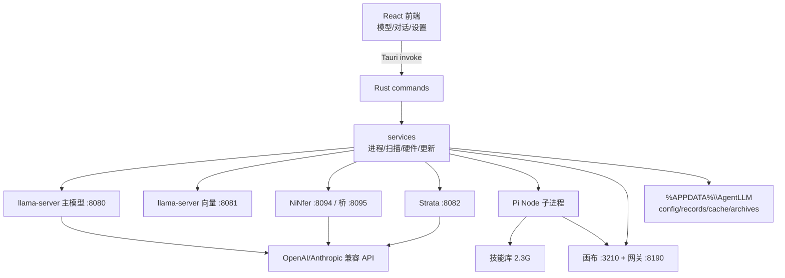
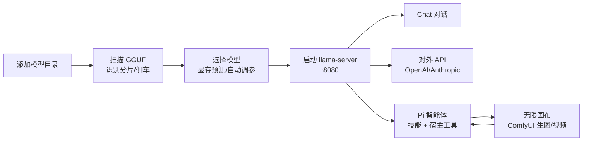

# 拾壹（Agent LLM）项目指南

> **定位**：项目全景 + 双层项目总览表 + 功能地图 + 文档阅读路径。  
> **适用版本**：v0.5.0（`app/package.json` 与 `app/src-tauri/tauri.conf.json` 一致）  
> **配套版本**：无限画布包 v0.25.3 · Pi 内核 1.5.0 · 托管 Node 24.15.0  
> **证据基线**：2026-11-22 当前工作树（含未提交改动；见 [§6.2](#62-当前未提交改动)）  
> **不替代**：操作步骤看 [USER_MANUAL.md](USER_MANUAL.md)，开发构建看 [DEVELOPMENT_GUIDE.md](DEVELOPMENT_GUIDE.md)，界面规范看 [UI_DESIGN_GUIDE.md](UI_DESIGN_GUIDE.md)。

---

## 0. 一分钟看懂

- **一句话**：拾壹是一个 Windows 本地大模型启动器——把 `.gguf` 变成可对话、可被局域网调用、可执行智能体任务的本地推理服务。
- **三条推理后端**：主模型 `llama-server`（8080）、NiNfer（8094）、Strata（8082）；**三者显存互斥**，启动任一个前会先停另外两个。
- **两类扩展**：Pi 智能体（Node 子进程 + 宿主工具代理 + 技能库）与无限画布（外挂 Web + ComfyUI 网关）。
- **三大工作区**：模型/引擎/智能体（内部代号 `agent`）、对话（`chat`）、设置（`settings`）。
- **文档地图**：本指南负责“有哪些项目、各自小类在哪”；具体怎么点按钮看使用说明书。

**按目的跳转**

| 你想知道 | 去哪里 |
| --- | --- |
| 仓库里到底有哪些子产品/工程 | [§2.1 上层总览表](#21-上层工程与子产品) |
| 某个页面下有哪些小功能 | [§2.3 应用功能地图](#23-下层应用功能地图) |
| 端口、数据目录、配置字段 | [§3 运行事实](#3-运行事实端口目录与进程) |
| 怎么构建、测试、打包 | [§4 开发与发布](#4-开发构建与测试) |
| 哪些文档过时了 | [§5.2 文档冲突与过时点](#52-文档冲突与过时点) |
| 现在做到哪、下一步是什么 | [§6 现状与计划](#6-现状计划与已知缺口) |

---

## 1. 项目定位与边界

### 1.1 是什么

拾壹（仓库名 Agent_LLM，产品名 Agent LLM）面向 **Windows 本机运行大模型** 的场景，把以下麻烦事收进一个桌面应用：

- 下载/校验/切换 llama.cpp 内核（CUDA / Vulkan / ROCm 自动匹配）；
- 扫描模型目录，识别分片、`mmproj`、MTP / DSpark / DFlash 侧车；
- 估算显存、按本机硬件自动调参、记录实测校准；
- 启动/停止推理服务，并开放 OpenAI / Anthropic 兼容 API；
- 用 Pi 执行本地智能体任务，用无限画布做本地生图/视频；
- 托管 NiNfer 与 Strata 两条额外推理引擎。

### 1.2 不是什么

- **不是云端服务**：默认只监听本机；开放局域网需显式操作并配置鉴权。
- **不是模型仓库**：仓库与便携包**不含** `.gguf`、`llama-server.exe`、DLL 与技能库之外的模型资产。
- **不是跨平台产品**：仅 Windows 10/11 验证；代码含 Windows 专属实现。
- **不是多用户系统**：数据落在当前用户 `%APPDATA%\AgentLLM`。

### 1.3 硬约束

| 约束 | 说明 | 证据 |
| --- | --- | --- |
| 三后端互斥 | 主模型 / NiNfer / Strata 共享显存，启动前硬闸门会停掉另外两个 | `app/src-tauri/src/services/backend_gate.rs` |
| 技能库独立分发 | 技能库约 2.3 G，不进安装包；首次使用需指定目录 | `app/resources/pi/skills`、README §4.3 |
| 画布端口固定 | 画布数据按 origin 存浏览器存储，改端口等于换 origin | `app/src/lib/ipc/canvas.ts`、`CANVAS_MODULE.md` |
| 会话存 localStorage | 配额 5–10 MB；写满已有全局警告条，但附件 data URL 会被剥离 | `app/src/components/StorageWarningBanner.tsx`、`app/src/features/chat/chatUtils.ts` |
| 中文优先 | 界面与文档以中文为第一语言，暂无国际化 | README §7 |

---

## 2. 双层项目总览

用户要看的“项目表格”分两层：

- **上层**：仓库里有哪些可独立说明的工程/子产品（含历史下线的）；
- **下层**：拾壹应用内部的功能模块与页面小类。

### 2.1 上层：工程与子产品

| # | 工程 / 子产品 | 形态 | 职责 | 代码或资源入口 | 运行形态 | 状态 |
| --- | --- | --- | --- | --- | --- | --- |
| 1 | 拾壹桌面应用 | Tauri 2 桌面壳 | 产品主体：窗口、托盘、单实例、资源目录 | `app/`、`app/src-tauri/` | `agent-llm.exe` | 在用 |
| 2 | React 前端 | SPA（React 19 + TS + Vite） | 三工作区界面与交互 | `app/src/` | WebView2 | 在用 |
| 3 | Rust 宿主后端 | Tauri commands + services | 进程、文件、硬件探测、内核更新、配置 | `app/src-tauri/src/` | 随桌面应用 | 在用 |
| 4 | 主推理链路 | 外部 llama.cpp 内核 | 对话 / 视觉 / 补全 / 对外 API | `app/src-tauri/src/commands/server.rs`、`resources/kernels` | 子进程 `llama-server` :8080 | 在用 |
| 5 | 向量 / 重排服务 | 独立 llama-server 实例 | Embedding / Rerank | `app/src-tauri/src/services/embedding_manager.rs` | 子进程 :8081 | 在用 |
| 6 | NiNfer（fast-27b） | 外部引擎 + 管理器 | Bonsai / Saluki 27B 推理 | `services/fast27b_manager.rs`、`app/resources/fast-llm/engine` | 子进程 :8094；网页桥 :8095 | 在用 |
| 7 | Strata | 外部 Python 引擎 + 管理器 | 90 GiB MoE 强推理 | `services/strata_manager.rs` | 子进程 :8082 | 在用 |
| 8 | Pi 智能体内核 | 外部 Node CLI + 宿主代理 | 任务执行、工具代理、权限三档、长期记忆 | `services/pi_agent.rs`、`services/pi_tools.rs`、`services/pi_install.rs` | 常驻 Node 子进程 | 在用（1.5.0） |
| 9 | Pi 技能库 | 独立资产 | 两级技能索引、路由与正文注入 | `app/resources/pi/skills`、`services/pi_skills.rs` | 被宿主读取 | 在用（2.3 G / 209 个可索引技能 / 16 分类） |
| 10 | 无限画布外挂模块 | 外挂 Web + ComfyUI 网关 | 生图 / 视频 / 画布项目 | `app/resources/canvas`、`services/canvas_manager.rs` | 画布 :3210 + 网关 :8190（托管 Node） | 在用（v0.25.3） |
| 11 | Pi × 画布联动 | 宿主工具桥 | 画布状态、工作流、生图/图生图、产物续作 | `services/canvas_agent.rs`、`services/pi_tools.rs` | 随 Pi / 画布 | 部分（“选中项交给 Pi”未实施） |
| 12 | 对外 API | OpenAI / Anthropic 兼容 | 局域网调用与鉴权 | `commands/server.rs`、`app/src/features/apiStatus/` | 复用后端进程 | 在用 |
| 13 | 托管工具链 | Node / ffmpeg | 画布运行时与媒体处理 | `services/node_installer.rs`、`services/ffmpeg_installer.rs`、`app/src-tauri/resources/tools` | 按需安装 | 在用 |
| 14 | 桌面浮层 | Pi 浮窗 + 浮窗宠物 | 快聊、截图翻译；宠物为设置入口 | `app/src/pages/PiFloatApp.tsx`、`app/src/pages/PetPage.tsx` | Tauri 多窗口 / 设置页 | Pi 浮窗在用；宠物占位 |
| 15 | 开发与发布脚本 | bat / ps1 / mjs | 开发启动、便携包、画布包 | `scripts/`、`app/scripts/` | 手动执行 | 在用 |
| 16 | 回归测试套件 | `node --test` | 前端逻辑与引擎解析回归 | `app/scripts/*.test.mjs`（17 个） | 手动执行 | 在用 |
| 17 | 文档体系 | Markdown | 指南 / 计划 / 报告 / 归档 | `docs/` | — | 在用 |
| 18 | 拾一 sidecar（历史） | 外部 Python 进程 | 已被 Pi 取代；仅保留技能打分口径来源 | `services/pi_skills.rs` 注释、`CHANGELOG.md` | 无 | 历史 |
| 19 | dsh（DeepSeek Harness，历史） | 外部 Node sidecar | 已整体下线（2026-11-06） | 已删除；CHANGELOG 有记录 | 无 | 历史 |

> 说明：第 18 行容易误读。项目记忆与旧文档曾记录“拾一 sidecar 已接入”，但当前代码中已无 shiyi 运行时与 Tauri 命令；技能打分口径仍沿用拾一时期的实测结论。以当前代码为准。

### 2.2 架构总览

### 2.3 下层：应用功能地图

层级约定：**工作区 → 页面/子视图 → 小类（功能点）**。左侧导航标签以代码为准（`WorkspaceShell.tsx`、`ModelWorkspace.tsx`、`SettingsWorkspace.tsx`、`AgentPage.tsx`）。

> 与 `USER_MANUAL.md` §2 的分工：本表用于快速定位与状态判断，按钮级操作步骤以使用说明书为准；两处若冲突，以代码和 USER_MANUAL 的具体步骤为准。

#### 2.3.1 模型 / 引擎 / 智能体工作区（内部代号 `agent`）

| 页面 / 子视图 | 入口 | 小类（功能点） | 关键实现 |
| --- | --- | --- | --- |
| 模型列表 | 左侧栏「模型列表」 | 扫描本地 GGUF、刷新、搜索、排序（默认/名称/参数量从小到大/更新时间）、1/2 列切换、模型卡片（能力标签）、魔搭入口、空态引导、清理已删模型的运行记录 | `pages/HomePage.tsx`、`commands/model.rs`、`services/model_scanner.rs` |
| 模型加载 | 点击模型卡片 | ① 参数：上下文、GPU 卸载、KV 卸载、快速注意力、ubatch、KV 量化、MoE/稠密 FFN 卸载、线程、parallel、mmap/mlock、草稿与 MTP、模板、种子；② 信息：发布日期/许可/参数量/嵌入维度；③ 显存预测与实测校准；④ 自动调参（固定 ctx 找边界再复测）；⑤ 运行记录；⑥ 加载/停止/重置；⑦ 模型头像与主题色；⑧ API 调用名；⑨ AMD 专项建议 | `pages/ModelLoadPage.tsx`、`features/model/ModelLoadView.tsx`、`commands/benchmark.rs` |
| 向量服务 | 左侧栏「向量服务」 | 选择 embedding / rerank 模型、端口、池化方式、归一化、启停、状态与日志；可与对话模型并行 | `features/embedding/EmbeddingWorkspace.tsx`、`commands/server.rs` |
| Agent · Pi | 左侧栏「Agent」→「Pi」 | 状态卡、随应用启动、模型端点自动对接（NiNfer→Strata→主模型）、Node/CLI/配置目录/工作区根/会话目录、运行日志；安装/升级/回滚在核心更新页 | `pages/agent/PiPanel.tsx`、`services/pi_agent.rs` |
| Agent · 技能 | 「Agent」→「技能」 | 16 分类技能树（大类→子类→技能）、触发词/排除词/工具/正文体量、关联技能、两级路由试跑（零模型成本）、路由开关 | `pages/SkillsPage.tsx`、`services/pi_skills.rs` |
| Agent · 画布 | 「Agent」→「画布」 | 环境检查（Node/画布包/ComfyUI/网关）、连接与端口、工作流列表与“交给 Pi”、启动/停止/打开窗口/浏览器、数据目录、网关日志 | `pages/agent/CanvasPanel.tsx`、`services/canvas_manager.rs` |
| NiNfer | 左侧栏「NiNfer」 | 概览/性能、Bonsai 与 Saluki 切换、启停/重启、端口/ctx/草稿长度、接入信息（Base URL/模型 ID/Key）、局域网开放、日志、网页桥 | `pages/Fast27bPage.tsx`、`services/fast27b_manager.rs` |
| Strata | 左侧栏「Strata」 | 概览/性能/日志、启停/重启、模型选择、配置、指标、日志暂停 | `pages/StrataPage.tsx`、`services/strata_manager.rs` |
| 服务状态（API 服务） | 左侧栏「服务状态」 | 性能面板（GPU/显存/温度/内存/带宽/余量，2 分钟趋势）、API 服务（状态/端口/协议/鉴权/Key/访问范围/立即检测）、高级设置、对外 API、跟随当前对话后端 | `features/apiStatus/*` |
| llama 日志 | 左侧栏「llama 日志」 | 实时日志、暂停/恢复、清空 | `pages/LlamaLogsPage.tsx` |

#### 2.3.2 对话工作区（`chat`）

| 页面 / 子视图 | 入口 | 小类（功能点） | 关键实现 |
| --- | --- | --- | --- |
| 主对话 | 切换到对话界面 | 流式回复、思考挡位、工具/MCP、附件（图片/PDF 等）、交付护栏、产物卡、停止/重试、标题生成 | `pages/ChatPage.tsx`、`features/chat/*` |
| 会话侧栏 | 对话页左侧 | 主对话 ↔ Pi 工作区切换、新建对话、搜索（会话与正文）、会话列表、导出、性能指标（ctx/显存/内存/GPU）、折叠与宽度拖拽 | `features/chat/ChatSidebar.tsx`、`sessionExport.ts` |
| Pi 工作区 | 侧栏头像切换 | 真实本地文件夹工作区、权限三档（只读/守门/放行）、Pi 会话、技能注入、产物、工作区文件与命令代理 | `pages/ChatPage.tsx`、`lib/workspaces.ts` |
| 右侧工作面板 | 对话页右侧 | 文件树与预览（文本/图片/PDF）、终端、内置浏览器、画布 iframe、对话参数（温度/Top P/重复惩罚/最大 Token/系统提示预设） | `features/chat/ChatWorkPanel.tsx`、`ChatSettingsPanel.tsx` |
| 引擎选择 | 全局自动 | 按“谁在跑”自动选择主模型 / NiNfer / Strata；切换后端不重置对话 | `hooks/useAutoChatEngine.ts` |
| Pi 浮窗 | 标题栏机器人按钮 | 快聊当前 Pi 会话、粘贴/拖入截图（最多 3 张）、截图翻译、发送/取消、占用互斥 | `pages/PiFloatApp.tsx` |

#### 2.3.3 设置中心（`settings`）

| 页面 | 小类（功能点） | 关键实现 |
| --- | --- | --- |
| 软件设置 | 主题模式、字体大小、系统主题色同步、毛玻璃、减少动画、发送快捷键、模型目录、网络代理、托盘模式、数据/核心更新入口 | `pages/SettingsPage.tsx` |
| 核心更新 | 环境检测、组件更新（Pi → llama → Strata → NiNfer → ffmpeg）、内核状态、版本列表、安装/回滚 | `pages/KernelUpdatePage.tsx`、`services/update_center.rs` |
| 使用统计 | 使用详情、Token 用量、模型用量、热力图 | `pages/UsagePage.tsx` |
| 工具 | 原生工具（llama.cpp 内置，随模型加载）开关、MCP 服务器（stdio/http/sse）增删连断、合并为同一份工具清单 | `pages/ToolsPage.tsx`、`commands/mcp.rs` |
| WebUI 测试 | 后端选择（主模型/NiNfer/Strata）、官方 WebUI 入口、NiNfer 同源桥、`/v1/models` 连通性测试 | `pages/agent/AgentWebUiPanel.tsx`、`services/webui_bridge.rs` |
| 设备详情 | 显卡与显存、自动调参依据（90% 预算/建议线程）、处理器与内存、内核与存储、AMD 后端建议 | `pages/DevicePage.tsx`、`services/device_probe.rs` |
| 浮窗宠物 | 占位页，暂未启用（没有预埋假开关） | `pages/PetPage.tsx` |
| 数据管理 | 目录设置（模型目录、引擎、日志、归档）、清除对话历史、清除用量、清除扫描缓存、重置配置、出厂重置 | `pages/DataManagementPage.tsx`、`commands/storage.rs` |

#### 2.3.4 跨页能力

| 能力 | 说明 | 关键实现 |
| --- | --- | --- |
| 首次环境检测 | 首次启动自动检测，未通过弹窗 | `features/workspace/EnvCheckDialog.tsx`、`commands/env_check.rs` |
| 存储配额警告 | localStorage 写失败时全局警告条 | `components/StorageWarningBanner.tsx` |
| 错误边界 | 界面渲染失败时给出重载入口 | `App.tsx` |
| 主题与令牌 | Fluent 令牌、字体、图标、动效规则 | `workspace-design.css`、`docs/guides/UI_DESIGN_GUIDE.md` |

### 2.4 端到端主链路

---

## 3. 运行事实：端口、目录与进程

### 3.1 端口

| 端口 | 用途 | 来源 | 备注 |
| --- | --- | --- | --- |
| 3000 | Vite 前端开发服务器 | `tauri.conf.json` `devUrl` | 仅开发模式 |
| 8080 | 主模型 / 对话 / VLM | `models/app_state.rs` `default_port` | 可在配置中修改 |
| 8081 | 向量 / 重排服务 | `default_embedding_port()` | 与 8080 不同，才能并行 |
| 8094 | NiNfer | `Fast27bConfig::default()` | Bonsai / Saluki |
| 8095 | NiNfer 网页桥 | `Fast27bConfig::default()` | 同源包装官方 WebUI |
| 8082 | Strata | `StrataConfig::default()` | 注释明确避开 8080/8081/8094 |
| 3210 | 无限画布前端 | `services/canvas_manager.rs` | 固定端口，保证画布项目不丢 |
| 8190 | ComfyUI 网关 | `services/canvas_manager.rs` | 画布与 ComfyUI 之间 |

> 历史端口：dsh 3080（见 `docs/archive/`）；拾一 sidecar 已无运行时，不再占端口。

### 3.2 数据与配置目录

| 内容 | 默认路径 | 证据 |
| --- | --- | --- |
| 应用配置 | `%APPDATA%\AgentLLM\config.json` | `services/storage_paths.rs` |
| 模型运行记录 | `%APPDATA%\AgentLLM\model_records.json` | README §5.1 |
| 扫描缓存 | `%APPDATA%\AgentLLM\cache\` | README §5.1 |
| 聊天归档 | `%APPDATA%\AgentLLM\archives\` | `default_archive_dir()` |
| Pi 数据 | `%APPDATA%\AgentLLM\pi\`（agent / sessions / work） | README §4.3 |
| NiNfer / Strata / 画布 | `%APPDATA%\AgentLLM\fast27b`、`strata`、`canvas` | `canvas_manager.rs`、README §5.1 |
| llama.cpp 内核 | 应用资源目录 `resources/kernels/`（可覆写） | `default_engine_dir()` |
| 托管工具 | `app/src-tauri/resources/tools` / 安装目录 | `ffmpeg_installer.rs`、`node_installer.rs` |
| 对外 API Key | Windows 凭据管理器（`Agent LLM External API`） | README §5.1 |
| 会话历史 | 前端 localStorage（5–10 MB） | README §7 |

### 3.3 关键配置字段

| 字段 | 含义 | 默认 |
| --- | --- | --- |
| `model_dirs` | 模型扫描目录 | 空 |
| `default_port` | 对话/VLM 端口 | 8080 |
| `embedding_port` | 向量/重排端口 | 8081 |
| `api_enabled` / `api_host` / `api_key` | 对外 API | 关 / 本机 / — |
| `proxy_url` | HTTP(S) 代理 | 空 |
| `kernel_override_path` | 自编译内核路径 | 空 |
| `engine_dir` / `log_dir` / `archive_dir` | 三类可配置目录 | 见 §3.2 |
| `model_presets` / `tune_history` | 每模型参数记忆 / 调参历史 | — |
| `mcp_servers` | MCP 服务器列表 | 空 |
| `fast27b` / `strata` | 两条引擎的接入配置 | — |
| 画布配置 | **独立文件**，不在 `config.json`：`%APPDATA%\AgentLLM\canvas\config.json` | `canvas_manager.rs` `config_path()` |

### 3.4 进程与回收

- **主模型与向量服务**可同时运行（端口不同）；**主模型 / NiNfer / Strata** 三者互斥，由 `backend_gate.rs` 硬闸门保证。
- **Pi** 是常驻 Node 子进程，退出应用时回收进程树；Pi 内置文件/命令工具被禁用，全部经宿主代理与权限档判定。
- **画布**由托管 Node 启动；热重启或强杀后会按 PID 文件清理残留网关（`stop_stale_runtime()`）。
- 子进程隐藏窗口（Windows `creation_flags`），异常退出依赖 Job Object 回收进程树。

---

## 4. 开发、构建与测试

### 4.1 命令表

在 `app/` 目录下：

| 命令 | 作用 |
| --- | --- |
| `npm run dev` | 仅前端，浏览器 `http://127.0.0.1:3000`（无推理后端） |
| `npm run desktop` | Tauri 桌面开发模式，前端热重载 |
| `npm run desktop:build` | 生产构建 + 画布包 staging |
| `npm run build` | 类型检查 + 前端构建 |
| `npm run lint` | ESLint |
| `npm test` | 回归测试（扫描 `app/scripts/*.test.mjs`） |
| `npm run portable:zip` | 打包便携版 zip |
| `npm run tauri` | 透传 Tauri CLI |

Rust 侧：`cd app/src-tauri && cargo check`。

根目录脚本：

| 脚本 | 作用 |
| --- | --- |
| `scripts/dev-mode.bat` | 跑 `npm run desktop`（debug） |
| `scripts/start-agent-llm.bat` | 跑正式版 exe；缺失时检查环境并构建 |
| `scripts/start-swift27b-64k.bat` / `stop-swift27b.bat` | 27B 调优预设；停止脚本会结束全机 `llama-server.exe` |
| `scripts/pack-llama-webui.mjs` | 打包 llama.cpp 官方 WebUI 资产 |

### 4.2 测试清单

`npm test` 目前执行 17 个回归脚本：

`artifact-gate`、`attachment-transfer`、`autotune`、`completion-metrics`、`delivery-guard`、`fast27b-log`、`fast27b-media`、`fast27b-metrics`、`mindmap`、`model-state`、`pi-events`、`service-usage`、`session-export`、`session-search`、`usage-heatmap`、`vram-estimate`、`vram-measurement`（均位于 `app/scripts/*.test.mjs`）。

> 本指南只做静态事实核对，**本轮未执行** `npm test`、`cargo test` 或桌面真机交互。

### 4.3 打包与发布

| 产物 | 方式 | 备注 |
| --- | --- | --- |
| 桌面 exe | `npm run desktop:build` | `app/src-tauri/target/release/agent-llm.exe` |
| 便携包 | `npm run portable:zip` | `app/dist-portable/Agent_LLM_Portable_v<版本>.zip`，不含内核与模型 |
| 画布包 | `app/scripts/sync-canvas-pack.ps1` → `build-canvas-pack.ps1` | 当前 v0.25.3；改包后必须同步 `canvas-pack.release.json` 与 `CanvasPanel.tsx` 的下载源 |
| 画布 staging | `package-portable.ps1` / `stage-canvas-pack.ps1` | 出包时把画布模块放到 exe 旁边 |

### 4.4 仓库边界

- 根目录只放文档与配置：`README` / `LICENSE` / `CHANGELOG` / `CONTRIBUTING` / `AGENTS`。
- 应用源码在 `app/`；文档在 `docs/`；独立脚本在 `scripts/`。
- 不提交：`.gguf`、内核二进制、`node_modules`、`target/`、`dist/`、技能库之外的模型资产。
- **多会话并行风险**：工作树可能被其他会话改动；提交前先核对 `git status`，只暂存本会话的改动。

---

## 5. 文档体系与阅读路径

### 5.1 现有文档地图

| 文档 | 定位 | 适用版本 | 建议 |
| --- | --- | --- | --- |
| `README.md` | 安装、运行、配置、FAQ、已知限制 | 0.5.0 | 首次接触先读 |
| `docs/guides/USER_MANUAL.md` | 完整使用说明书：界面地图、加载参数、对话、Pi、引擎、画布、API、设置、排障 | 0.5.0 | 操作细节查这里 |
| `docs/guides/PI_AGENT_GUIDE.md` | Pi 专项：运行链路、配置、权限、技能路由、排障 | 0.5.0 / Pi 1.5.0 | 用 Pi 前读 |
| `docs/guides/DEVELOPMENT_GUIDE.md` | 开发、构建、调试、扩展、测试、故障排查 | 未标注（按当前工作树） | 改代码前读 |
| `docs/guides/TECHNICAL_REPORT.md` | 架构、数据流、模块清单、IPC | **v0.3.1（过时）** | 架构思路可参考，字段以代码为准 |
| `docs/guides/UI_DESIGN_GUIDE.md` | 设计边界、令牌、字体、动效、组件规则 | 持续维护 | 改界面前必读 |
| `docs/guides/CANVAS_MODULE.md` | 画布外挂模块：端口、数据目录、打包发布 | v0.25.3 | 改画布/发版时读 |
| `docs/AGENT_PROTOCOL.md` | **现行 Pi 宿主集成协议**：Rust 宿主 ↔ Pi Node 子进程的实际契约（旧 stdio 设计仅历史沿革） | 0.5.0 / Pi 1.5.0 | 改 `pi_*` 代码前必读 |
| `docs/guides/SWIFT27B_TUNING.md` | 27B 调优 A/B 与已知坑 | 2026-09 | 调 27B 参考 |
| `docs/plans/ROADMAP.md` | 路线图 | **基线 v0.3.1（过时）** | 只作历史参考 |
| `docs/plans/POST_0.5_BACKLOG.md` | 0.5 后清单 | 持续更新 | 看下一步做什么 |
| `docs/plans/CANVAS_AGENT_LINKAGE_PLAN.md` | 画布 × Pi 联动 | M1–M3 已实施 | 看“未实施”部分即可 |
| `docs/plans/COMFY_IMAGE_WORKSPACE_PLAN.md` | ComfyUI 生图工作区 | 待执行（基线过时） | 已被画布模块部分覆盖，需重定界 |
| `docs/plans/DYNAMIC_GGUF_DRAFTER_PLAN.md` | MTP/DSpark/DFlash | Phase 1–3 已实施 | Phase 4 待做 |
| `docs/plans/WIN7_REPLICA_PLAN.md` | Win7 复刻 | 未执行 | 历史方案 |
| `docs/reports/` | 一次性专题报告与验证记录 | 按日期 | 追溯决策与实测 |
| `docs/archive/` | 已完成/已放弃/已回滚 | 历史 | 仅参考，不删除 |

### 5.2 文档冲突与过时点

以下是本次核对发现的**事实性冲突、过时点与历史误记**，写作与排障时应以本指南口径为准：

| # | 位置 | 问题 | 当前事实 |
| --- | --- | --- | --- |
| 1 | `TECHNICAL_REPORT.md` 开头 | 标注“当前可运行版本 v0.3.1” | 当前 0.5.0；架构章节仍可参考，版本/模块清单已滞后 |
| 2 | `plans/ROADMAP.md` 开头 | 基线 v0.3.1（2026-09-02） | 未覆盖 0.4 / 0.5；路线图需重排 |
| 3 | `docs/README.md` 原索引 | 把 `CANVAS_AGENT_LINKAGE_PLAN.md` 标为“仅规划，未实施” | 计划头写明 M1 只读 / M2 生图 / M3 图生图已实施；仅“画布选中项交给 Pi”未实施（本轮已修正索引） |
| 4 | `README.md` §4.3、`PI_AGENT_GUIDE.md` §6.2、`USER_MANUAL.md` §7.1 | 技能数写作 238 / 239 / 239 | 扫描器只统计根目录下含 `SKILL.md` 的技能目录：211 个目录中 **209 个可索引**（全树共 313 个 `SKILL.md`，嵌套子技能不计入顶层索引）；技能库约 2.3 G |
| 5 | `README.md` §7 | “localStorage 配额写满后写入是静默失败的，界面不会提示” | 已新增 `StorageWarningBanner`：配额失败先降级重试，仍失败时全局警告（CHANGELOG Unreleased）；该条限制已失效 |
| 6 | `plans/COMFY_IMAGE_WORKSPACE_PLAN.md` | 状态“待执行（基线 v0.3.1）”，按自建生图工作区规划 | 当前已通过“无限画布 + ComfyUI 网关”提供生图/视频；计划需重新界定是否仍单独建设 |
| 7 | `CanvasPanel.tsx` 在线安装文案 | 写“约 4.7 MB” | `canvas-pack.release.json` 记录 5,615,540 字节（约 5.36 MiB）；界面文案滞后 |
| 8 | 旧项目记忆 / 旧文档 | 记录“拾一 sidecar 已接入” | 当前代码无 shiyi 运行时；仅技能打分口径沿用其结论（`services/pi_skills.rs` 注释可证） |

### 5.3 按角色的阅读路径

- **使用者**：README §2–§4 → USER_MANUAL §3–§13 → PI_AGENT_GUIDE（用 Pi 时）→ 本指南 §2.3 查功能位置。
- **前端开发**：DEVELOPMENT_GUIDE §3–§5 → UI_DESIGN_GUIDE → 本指南 §2.3 → `app/src/pages` 对读。
- **后端开发**：DEVELOPMENT_GUIDE §3 → 本指南 §2.1/§3 → `app/src-tauri/src/{commands,services,models}`。
- **发布/运维**：README §2.4/§5 → 本指南 §4.3 → CANVAS_MODULE → CHANGELOG。

---

## 6. 现状、计划与已知缺口

### 6.1 版本口径（已核对一致）

| 项 | 版本 | 证据 |
| --- | --- | --- |
| 应用 | 0.5.0 | `app/package.json`、`app/src-tauri/tauri.conf.json`、README 顶部 |
| 无限画布包 | 0.25.3 | `app/resources/canvas-pack.release.json` |
| Pi 内核 | 1.5.0 | PI_AGENT_GUIDE 顶部 |
| 托管 Node | 24.15.0 | `services/canvas_manager.rs` |

### 6.2 当前未提交改动

截至 2026-11-22，工作树有 **28 个已跟踪文件**改动（+1403 / −3672 行），主要范围：

- **前端重构**：`AppContext.tsx`、`ChatPage.tsx` 大幅拆分（两项合计净减约 3305 行；连同 `ChatBubble` 等新增，六个前端文件合计净减约 2977 行），`ChatSidebar`、`ChatWorkPanel`、`PiRuntimeContext` 调整；
- **Pi / 工具**：`pi_tools.rs`、`pi_host_tools.ts`、`ipc/pi.ts`、`commands/pi_agent.rs` 扩展；
- **画布**：`canvas_manager.rs`、`CanvasPanel.tsx`、画布包脚本与 release 元数据；
- **更新/环境**：`auto_updater.rs`、`ffmpeg_installer.rs`、`build.rs`、`resources/tools/README.txt`；
- **文档**：`CHANGELOG.md`、`README.md`、`USER_MANUAL.md`、`CANVAS_MODULE.md`、`docs/README.md`。

> 本指南以该工作树为准。提交/发布前应重新核对，避免把未完成改动写进发布说明。

### 6.3 计划状态

| 事项 | 状态 | 依据 |
| --- | --- | --- |
| Pi 内核收口（安装/升级/回滚/权限/技能路由） | 已完成 | POST_0.5_BACKLOG P0/P1 |
| 画布 × Pi 联动（只读/生图/图生图） | 已完成 | 计划头、CHANGELOG |
| 画布选中项“交给 Pi”按钮 | 未实施 | 计划头说明：画布前端无稳定全局 API |
| Dynamic GGUF Phase 4 | 待做 | DYNAMIC_GGUF_DRAFTER_PLAN |
| ComfyUI 独立生图工作区 | 待重定界 | COMFY_IMAGE_WORKSPACE_PLAN（基线过时） |
| Win7 复刻 | 未执行 | WIN7_REPLICA_PLAN |
| 浮窗宠物 | 占位 | `PetPage.tsx` |
| 桌面宠物互动 | 未开始 | 同上 |

### 6.4 已知限制（保留项）

- 仅 Windows 10/11 验证；仓库不含模型与内核二进制。
- 三条推理后端不能并行；`stop-swift27b.bat` 会结束全机 `llama-server.exe`。
- Pi 的命令执行不是 OS 级沙箱；`full` 档仍以当前用户权限执行。
- 会话历史在 localStorage，附件 data URL 落盘前会被剥离；写满有全局警告但不能自动扩容。
- 双份技能正文注入有上限（1–2 个技能、合计 8000 字符）；技能库缺失时任务质量下降。

### 6.5 本轮未覆盖

- 未启动桌面应用做真机点击验收（用户已确认本轮只整理文档）。
- 未执行 `npm test` / `cargo test`，未验证运行时端口占用与进程回收。
- 未核对第三方上游（ComfyUI、Pi、llama.cpp）的最新版本；以仓库锁定版本为准。

---

## 7. 维护约定

1. **版本升级时**：同步更新 §6.1 与 §2.1 的状态列；画布包升级同时更新 `canvas-pack.release.json` 与 `CanvasPanel.tsx` 的下载源。
2. **新增页面/子视图时**：在 §2.3 对应工作区表补一行，并在 `WorkspaceShell` / `ModelWorkspace` / `SettingsWorkspace` 中确认导航标签。
3. **技能库变更时**：重新统计“根目录下含 `SKILL.md` 的目录数”，不要沿用旧数字。
4. **计划完成/放弃时**：更新 §6.3，并在 `docs/README.md` 同步状态；归档只移动、不删除。
5. **发现文档冲突时**：先在本指南 §5.2 记录，再决定是否修正原文档，避免多处口径并存。

---

> 维护人：项目组。最后核对：2026-11-22。  
> 相关入口：[README](../../README.md) · [文档索引](../README.md) · [使用说明书](USER_MANUAL.md) · [开发指南](DEVELOPMENT_GUIDE.md) · [技术报告](TECHNICAL_REPORT.md) · [更新日志](../../CHANGELOG.md)
